# Лабораторная работа № 3
# CI/CD: автоматическая проверка, сборка и развёртывание приложения

## 1. Цель работы

Настроить CI/CD для приложения из лабораторной работы № 0 с использованием контейнеризации из лабораторной работы № 2. Продемонстрировать, что ошибочный код и образ с критическими уязвимостями блокируются до деплоя, а исправленная версия автоматически собирается, публикуется и запускается.

Спидран по CI/CD! Погналм!

## 2. Введение в курс дела
### 2.1 Файлики

| Файл | Назначение |
| --- | --- |
| [ci-bad.yml](../.github/workflows/ci-bad.yml) | Плохой, но работающий workflow |
| [ci-good.yml](../.github/workflows/ci-good.yml) | Основной workflow с проверками и автоматическим деплоем |
| [Dockerfile.bad](../backend/Dockerfile.bad) | Плохой докерфайл из лабораторной работы 2 |
| [Dockerfile](../backend/Dockerfile) | Хороший докерфайл |
| [Dockerfile.vulnerable](../backend/Dockerfile.vulnerable) | Образ для демонстрации security-gate с дебианом |
| [compose.deploy.bad.yaml](../compose.deploy.bad.yaml) | Развёртывание плохого варианта |
| [compose.deploy.good.yaml](../compose.deploy.good.yaml) | Развёртывание хорошего варианта с healthcheck |
| [healthy_test.go](../backend/server/healthy_test.go) | Тест HTTP-обработчика `/health` |

### 2.2 Подготовочка

Пришлось самому писать тест healthy_test.go, потому что разраб решил, что тесту нужны только трусам. По нему и будем всё тестировать, и если соизволят написать остальные тесты, они будут работать тоже.
``` go
  func TestHandleHealthReturnsOK(t *testing.T) {
	request := httptest.NewRequest(http.MethodGet, "/health", nil)
	response := httptest.NewRecorder()

	handleHealth(response, request)

	if response.Code != http.StatusOK {
		t.Fatalf(
			"expected status %d, got %d",
			http.StatusOK,
			response.Code,
		)
	}
}
```

Также у владельца репо был выпрошен self-hosted runner и запущен на моем компе, потому что моя жадная жопа не хочет платить 300 рублей за сервер. Это благополучно съело половину моей оперативы. Тяжело...
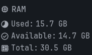

## 3. Плохой пайплайн


Первой идеей было слизать у другого проекта на go воркфлоу и ухудшить его. После долгих 3-х минут поиска я понял, что Вась много, и подход "И так сойдет" применяется много где. Так что ухудшать даже не пришлось)

### 3.1. Что он делает

Плохой workflow собирает образ через `backend/Dockerfile.bad`, публикует его в GHCR под именем `ghcr.io/tanzor-disco/based-todo-list-bad:latest` и запускает через Docker Compose на локальной машине.

Работа разделена на две job: `build` и `deploy`. Указание `needs: build` запрещает начинать деплой до завершения сборки и публикации. А проверки кода и безопасности идут в след за максом.

```yaml
name: Bad CI

on:
  push:
    branches:
      - lab3
    paths:
      - ".github/workflows/ci-bad.yml"
      - "compose.deploy.bad.yaml"

permissions:
  contents: read
  packages: write

jobs:
  build:
    name: Build and publish Docker image
    runs-on: ubuntu-24.04

    steps:
      - name: Checkout repository
        uses: actions/checkout@main

      - name: Prepare image name
        run: |
          echo "IMAGE=ghcr.io/${GITHUB_REPOSITORY,,}-bad:latest" >> "$GITHUB_ENV"

      - name: Build image
        run: |
          docker build \
            -f backend/Dockerfile.bad \
            -t "$IMAGE" \
            ./backend

      - name: Show image
        run: docker image ls "$IMAGE"

      - name: Login to GHCR
        env:
          GHCR_TOKEN: ${{ secrets.GITHUB_TOKEN }}
        run: |
          echo "$GHCR_TOKEN" | docker login ghcr.io \
            --username "$GITHUB_ACTOR" \
            --password-stdin

      - name: Push image
        run: docker push "$IMAGE"

  deploy:
    name: Deploy on local machine
    needs: build
    runs-on: [self-hosted, linux, x64, todo-deploy]

    permissions:
      contents: read
      packages: read

    steps:
      - name: Checkout repository
        uses: actions/checkout@main

      - name: Prepare image name
        run: |
          echo "APP_IMAGE=ghcr.io/${GITHUB_REPOSITORY,,}-bad:latest" >> "$GITHUB_ENV"
          echo "DOCKER_CONFIG=$RUNNER_TEMP/docker-config-bad" >> "$GITHUB_ENV"

      - name: Login to GHCR
        env:
          GHCR_TOKEN: ${{ secrets.GITHUB_TOKEN }}
        run: |
          mkdir -p "$DOCKER_CONFIG"
          echo "$GHCR_TOKEN" | docker login ghcr.io \
            --username "$GITHUB_ACTOR" \
            --password-stdin

      - name: Pull images
        run: |
          docker compose \
            --env-file "$HOME/todo-deploy/.env" \
            -p todo-lab3-bad \
            -f compose.deploy.bad.yaml \
            pull

      - name: Start application
        run: |
          docker compose \
            --env-file "$HOME/todo-deploy/.env" \
            -p todo-lab3-bad \
            -f compose.deploy.bad.yaml \
            up -d

      - name: Show containers
        run: |
          docker compose \
            --env-file "$HOME/todo-deploy/.env" \
            -p todo-lab3-bad \
            -f compose.deploy.bad.yaml \
            ps
```
Плохой вариант успешно собирался и развёртывался: [Bad CI, запуск № 7](https://github.com/Tanzor-Disco/based-todo-list/actions/runs/38782836698).
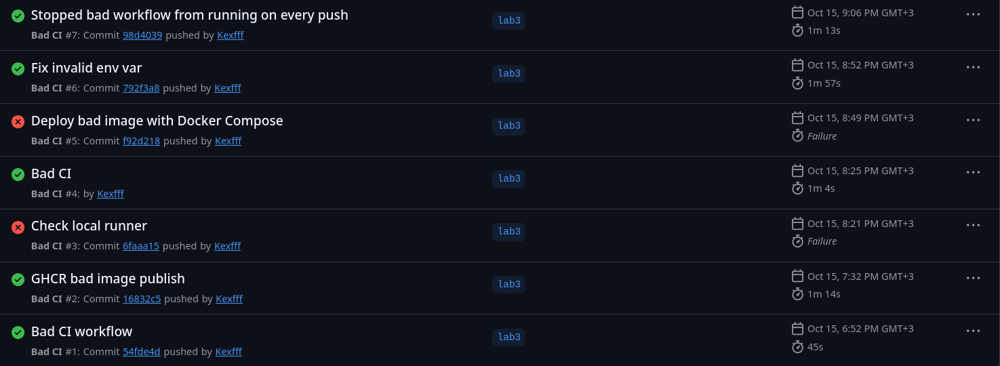
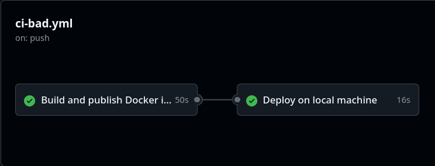


### 3.2. Допущенные bad practices

| Недостаток | Как проявляется | Почему это плохо |
| --- | --- | --- |
| Нет lint и тестов | Сразу выполняется `docker build` | Компилируемый код с ошибками поведения может попасть в среду запуска |
| Нет сканирования образа | После сборки сразу выполняется push | Известные критические CVE не блокируют публикацию и деплой |
| Незакреплённая версия action | Используется `actions/checkout@main` | Содержимое используемого action может измениться без изменения workflow |
| Плавающий базовый образ | В плохом Dockerfile используется `golang:latest` | Одинаковый исходный код может собираться с разными версиями Go |
| Только тег `latest` | Сборка и деплой используют один перезаписываемый тег | Сложнее установить, какой коммит запущен; тег может указывать уже на другую сборку |
| Нет внешнего кеша слоёв | Используется обычный `docker build` на временном runner | Кеш предыдущего запуска не сохраняется для следующей машины GitHub |
| Нет проверки готовности backend | После `up -d` выполняется только `docker compose ps` | Запуск контейнера ещё не доказывает, что HTTP-сервис отвечает |

У PostgreSQL в плохом Compose уже есть healthcheck. Недостаток заключается именно в отсутствии проверки готовности backend и финальной HTTP-проверки.

Даже в демонстрационном плохом варианте настоящие секреты не записывались в YAML (хотя очень хотелось): авторизация в GHCR использует `GITHUB_TOKEN`, а параметры базы поступают из локального файла `$HOME/todo-deploy/.env`.
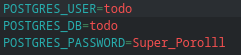

### 3.3. Сайтик

В целом приложение работает уже здесь.
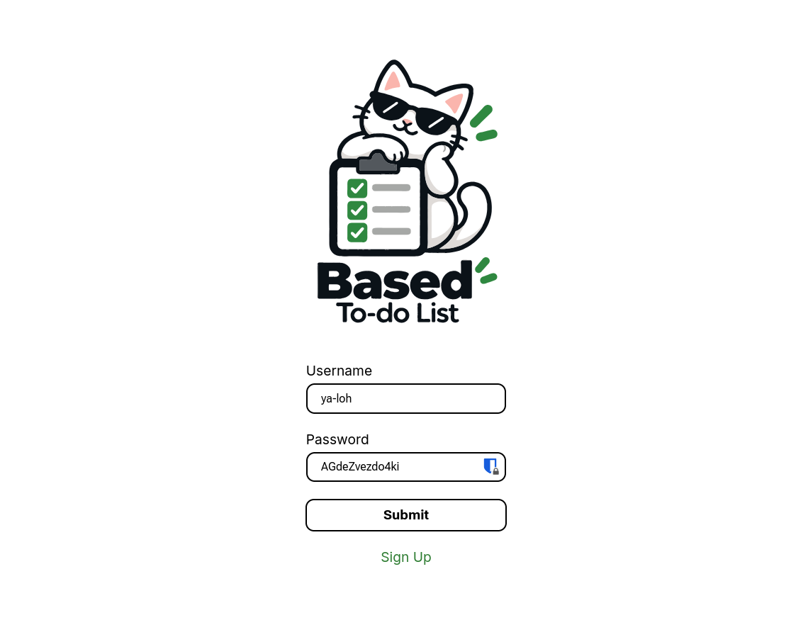

Всё работает. Хороший пайплайн избыточен. Лаба заклончена. Спасибо за внимание.

Ладно, нет.

## 4. Хороший пайплайн

Всё таки сделаем нормальный пайплайн раз очень просили.

### 4.1. Последовательность выполнения

```text
push в lab3
    ↓
проверка Go и frontend
    ↓
сборка frontend и Docker-образа
    ↓
отчёт Trivy → блокировка при наличии CRITICAL
    ↓
публикация проверенного образа в GHCR
    ↓
деплой этого образа по digest
    ↓
ожидание healthcheck → curl /health → сохранение результатов
```

Логически стадии реализованы шагами внутри двух job. Job `checks` выполняет проверку кода, сборку, сканирование и публикацию. Job `deploy` зависит от неё через `needs: checks`. Если тест или security-gate завершится с ошибкой, публикация не выполняется, а job деплоя получает статус `skipped`.

Так правильно и неинтересно... Вот бы ключи в публичный репо залить...

### 4.2. Проверка кода и подготовка приложения

Для Go выполняются:

```bash
gofmt -l .
go vet ./...
go test -v ./...
```

Workflow отдельно проверяет вывод `gofmt -l`: если есть неотформатированные файлы, шаг завершается с кодом `1`. `go vet` ищет подозрительные конструкции, а `go test` проверяет поведение, описанное тестами. Тест только один, но это не важно)
``` yaml
      - name: Check Go formatting
        working-directory: backend
        run: |
          unformatted="$(gofmt -l .)"
          if [ -n "$unformatted" ]; then
            printf 'Run gofmt for:\n%s\n' "$unformatted"
            exit 1
          fi

      - name: Check Go code
        working-directory: backend
        run: go vet ./...

      - name: Run Go tests
        working-directory: backend
        run: go test -v ./...
```

Для frontend выполняются:

```bash
npm ci
npm run lint -- --max-warnings=0
npm run build
```

`npm ci` устанавливает зависимости по `package-lock.json`. Параметр `--max-warnings=0` делает предупреждения линтера причиной провала проверки. Потому что простым путём мы не идем.

``` yaml
      - name: Install frontend dependencies
        working-directory: frontend
        run: npm ci

      - name: Lint frontend
        working-directory: frontend
        run: npm run lint -- --max-warnings=0

      - name: Build frontend
        working-directory: frontend
        run: npm run build
```

В данном приложении backend встраивает статические файлы frontend в исполняемый Go-файл. Поэтому перед Docker-сборкой результат `frontend/dist` копируется в `backend/server/static`. Особенности приложения, я хз.

``` yaml
      - name: Prepare frontend for backend
        run: |
           test -f frontend/dist/index.html
           rm -rf backend/server/static
           mkdir -p backend/server/static
           cp -a frontend/dist/. backend/server/static/
```

### 4.3. Кеширование

Используются три независимых кеша:

1. `actions/setup-go` кеширует зависимости и данные сборки Go с учётом `backend/go.sum`.
2. `actions/setup-node` кеширует данные npm с учётом `frontend/package-lock.json`.
3. Docker Buildx сохраняет слои через `cache-from: type=gha,scope=todo-good` и `cache-to: type=gha,mode=max,scope=todo-good`. Режим `max` сохраняет также промежуточные слои многоэтапной сборки.

В Dockerfile сначала копируются `go.mod` и `go.sum`, затем выполняется `go mod download`, и только после этого копируется остальной код. Изменение исходников без изменения зависимостей позволяет повторно использовать слой загрузки модулей.

### 4.4. Секреты, версии и права доступа

Для GHCR используется автоматически предоставляемый GitHub Actions секрет `${{ secrets.GITHUB_TOKEN }}`. Пароль PostgreSQL хранится в секрете репозитория `TODO_DB_PASSWORD` и передаётся в окружение job деплоя. В YAML нет открытого значения пароля. В `docker login` токен передаётся через `--password-stdin`.

``` yaml
      - name: Prepare image name
        run: |
           echo "IMAGE=ghcr.io/${GITHUB_REPOSITORY,,}:sha-${GITHUB_SHA}" >> "$GITHUB_ENV"
```

Job сборки имеет `packages: write`, поскольку публикует образ. Job деплоя имеет `packages: read`, поскольку только скачивает его. Для чтения репозитория используется `contents: read`, а checkout выполняется с `persist-credentials: false`.

Все actions хорошего workflow закреплены полными SHA коммитов, например:

```yaml
uses: actions/checkout@3d3c42e5aac5ba805825da76410c181273ba90b1 # v7.0.1
```

Также явно указаны версии Node.js `24.22.0`, Trivy `0.76.0`, Buildx `0.38.0`, BuildKit `0.34.0`, Go `1.26.9` и PostgreSQL `18.6-alpine3.24`. Runtime приложения использует `alpine:3.22`.

### 4.5. Почему сканируется именно публикуемый образ

Buildx выполняется с `load: true` и `push: false`. Сначала образ загружается в локальный Docker runner, затем Trivy сканирует его с `--image-src docker`. Только после успешного security-gate выполняется `docker push "$IMAGE"`. Повторной сборки между сканированием и публикацией нет.

Тег образа содержит полный SHA коммита:

```text
ghcr.io/tanzor-disco/based-todo-list:sha-<GITHUB_SHA>
```

После push workflow получает `RepoDigests` через `docker image inspect` и передаёт ссылку вида `ghcr.io/...@sha256:...` в job деплоя. Для передачи используются `$GITHUB_OUTPUT`, output job `checks` и `${{ needs.checks.outputs.image_ref }}`. Это связывает развёрнутую версию с конкретным опубликованным содержимым, независимо от дальнейших изменений тегов.

### 4.6. Деплой и проверка готовности

Хороший вариант использует отдельный Compose-проект `todo-lab3-good`, свой том PostgreSQL и порт `127.0.0.1:18081`. Плохой вариант использует проект `todo-lab3-bad` и порт `127.0.0.1:18080`. Это позволяет запускать оба варианта на одной машине без конфликта портов и смешивания данных.

В хорошем Compose у PostgreSQL проверяется готовность через `pg_isready`, а у backend — ответ `/health` через `wget`. Backend зависит от готовности базы. Команда:

```bash
docker compose up -d --wait --wait-timeout 120
```

ожидает готовности сервисов. Затем отдельный `curl` проверяет опубликованный на хосте порт. Параметр `--fail` делает ошибочный HTTP-ответ причиной провала шага, а `--max-time 10` ограничивает ожидание.

``` yaml
     - name: Check live service
       run: |
         mkdir -p deploy-evidence
         printf '%s\n' "$APP_IMAGE" > deploy-evidence/image.txt

         curl \
           --fail \
           --show-error \
           --silent \
           --include \
           --max-time 10 \
           --output deploy-evidence/health.txt \
           http://127.0.0.1:18081/health

         cat deploy-evidence/health.txt
         docker compose ps > deploy-evidence/containers.txt
         cat deploy-evidence/containers.txt
```

Для job деплоя задана группа `concurrency: todo-lab3-good-deploy`: несколько запусков этого workflow не должны одновременно менять один Compose-проект. При ошибке выводятся последние строки логов контейнеров.

### 4.7. Конфигурация

Вот полный workflow ci-good.yml, любуйтесь! А я пошел проклинать yaml, как же я от него устал...

```yaml
name: Good CI

on:
  push:
    branches:
      - lab3

permissions:
  contents: read

jobs:
  checks:
    name: Check code
    runs-on: ubuntu-24.04
    timeout-minutes: 30

    permissions:
          contents: read
          packages: write

    outputs:
          image_ref: ${{ steps.publish.outputs.image_ref }}


    steps:
      - name: Checkout repository
        uses: actions/checkout@3d3c42e5aac5ba805825da76410c181273ba90b1 # v7.0.1
        with:
          persist-credentials: false

      - name: Set up Go
        uses: actions/setup-go@b7ad1dad31e06c5925ef5d2fc7ad053ef454303e # v7.0.0
        with:
          go-version-file: backend/go.mod
          cache: true
          cache-dependency-path: backend/go.sum

      - name: Check Go formatting
        working-directory: backend
        run: |
          unformatted="$(gofmt -l .)"
          if [ -n "$unformatted" ]; then
            printf 'Run gofmt for:\n%s\n' "$unformatted"
            exit 1
          fi

      - name: Check Go code
        working-directory: backend
        run: go vet ./...

      - name: Run Go tests
        working-directory: backend
        run: go test -v ./...

      - name: Set up Node.js
        uses: actions/setup-node@949feb2413d6458794dcd2491c4babbbce0c15c1 # v7.1.0
        with:
          node-version: "24.22.0"
          cache: npm
          cache-dependency-path: frontend/package-lock.json

      - name: Install frontend dependencies
        working-directory: frontend
        run: npm ci

      - name: Lint frontend
        working-directory: frontend
        run: npm run lint -- --max-warnings=0

      - name: Build frontend
        working-directory: frontend
        run: npm run build

      - name: Prepare frontend for backend  # заменяет содержимое backend/server/static свежим результатом сборки frontend. Нужно из-за особеностей приложения
        run: |
           test -f frontend/dist/index.html
           rm -rf backend/server/static
           mkdir -p backend/server/static
           cp -a frontend/dist/. backend/server/static/

      - name: Prepare image name
        run: |
           echo "IMAGE=ghcr.io/${GITHUB_REPOSITORY,,}:sha-${GITHUB_SHA}" >> "$GITHUB_ENV"
      - name: Set up Docker Buildx
        uses: docker/setup-buildx-action@f87e5991a6d7451dcb8d9637bfbc97413f497069 # v4.4.1
        with:
          version: v0.38.0
          driver-opts: image=moby/buildkit:v0.34.0

      - name: Build image
        uses: docker/build-push-action@c3c9e263c25d99ce0380d002d59b67737d91b0dc # v7.4.0
        with:
          context: ./backend
          file: ./backend/Dockerfile
          platforms: linux/amd64
          load: true
          push: false
          tags: ${{ env.IMAGE }}
          cache-from: type=gha,scope=todo-good
          cache-to: type=gha,mode=max,scope=todo-good

      - name: Show image
        run: docker image ls "$IMAGE"

      - name: Install Trivy
        uses: aquasecurity/setup-trivy@81e514348e19b6112ce2a7e3ecbafe19c1e1f567 # v0.3.1
        with:
          version: v0.76.0
          cache: true

      - name: Create vulnerability report
        run: |
            mkdir -p trivy-reports
            printf '%s\n' "$IMAGE" > trivy-reports/image.txt

            trivy image \
              --image-src docker \
              --scanners vuln \
              --format json \
              --output trivy-reports/trivy.json \
              --exit-code 0 \
              "$IMAGE"

            trivy --version > trivy-reports/version.txt

      - name: Show vulnerability report
        run: |
            trivy convert \
              --format table \
              --output trivy-reports/trivy.txt \
              trivy-reports/trivy.json

            cat trivy-reports/trivy.txt

            jq '
              [.Results[]? | .Vulnerabilities[]?] |
              {
                CRITICAL: (map(select(.Severity == "CRITICAL")) | length),
                HIGH: (map(select(.Severity == "HIGH")) | length)
              }
            ' trivy-reports/trivy.json | tee trivy-reports/severity.json

      - name: Block CRITICAL vulnerabilities
        run: |
            trivy image \
              --image-src docker \
              --scanners vuln \
              --severity CRITICAL \
              --exit-code 1 \
              --skip-db-update \
              "$IMAGE"

      - name: Upload vulnerability reports
        if: always()
        uses: actions/upload-artifact@cf430e030ddbb5b0abf93d22962f4752f3646cd9 # v7.0.2
        with:
          name: trivy-reports-${{ github.sha }}
          path: trivy-reports/
          retention-days: 30
          if-no-files-found: ignore

      - name: Login to GHCR
        env:
          GHCR_TOKEN: ${{ secrets.GITHUB_TOKEN }}
        run: |
              printf '%s' "$GHCR_TOKEN" | docker login ghcr.io \
                --username "$GITHUB_ACTOR" \
                --password-stdin

      - name: Push scanned image
        id: publish
        run: |
          docker push "$IMAGE"

          image_ref="$(docker image inspect "$IMAGE" --format '{{index .RepoDigests 0}}')"
          echo "image_ref=$image_ref" >> "$GITHUB_OUTPUT"

  deploy:
   name: Deploy and check live service
   needs: checks
   runs-on: [self-hosted, linux, x64, todo-deploy]
   timeout-minutes: 10

   permissions:
     contents: read
     packages: read

   concurrency:
     group: todo-lab3-good-deploy
     cancel-in-progress: false

   env:
     APP_IMAGE: ${{ needs.checks.outputs.image_ref }}
     POSTGRES_USER: todo
     POSTGRES_DB: todo
     POSTGRES_PASSWORD: ${{ secrets.TODO_DB_PASSWORD }}
     COMPOSE_PROJECT_NAME: todo-lab3-good
     COMPOSE_FILE: compose.deploy.good.yaml

   steps:
     - name: Checkout repository
       uses: actions/checkout@3d3c42e5aac5ba805825da76410c181273ba90b1 # v7.0.1
       with:
         persist-credentials: false

     - name: Prepare deployment
       run: |
         if [ -z "$POSTGRES_PASSWORD" ]; then
           echo "Create the TODO_DB_PASSWORD repository secret"
           exit 1
         fi
         echo "DOCKER_CONFIG=$RUNNER_TEMP/docker-config-good" >> "$GITHUB_ENV"

     - name: Login to GHCR
       env:
         GHCR_TOKEN: ${{ secrets.GITHUB_TOKEN }}
       run: |
         mkdir -p "$DOCKER_CONFIG"
         printf '%s' "$GHCR_TOKEN" | docker login ghcr.io \
           --username "$GITHUB_ACTOR" \
           --password-stdin

     - name: Pull images
       run: docker compose pull

     - name: Start and wait for healthy service
       run: docker compose up -d --wait --wait-timeout 120

     - name: Check live service
       run: |
         mkdir -p deploy-evidence
         printf '%s\n' "$APP_IMAGE" > deploy-evidence/image.txt

         curl \
           --fail \
           --show-error \
           --silent \
           --include \
           --max-time 10 \
           --output deploy-evidence/health.txt \
           http://127.0.0.1:18081/health

         cat deploy-evidence/health.txt
         docker compose ps > deploy-evidence/containers.txt
         cat deploy-evidence/containers.txt

     - name: Show logs on failure
       if: failure()
       run: docker compose logs --tail 80

     - name: Upload deployment evidence
       if: always()
       uses: actions/upload-artifact@cf430e030ddbb5b0abf93d22962f4752f3646cd9 # v7.0.2
       with:
         name: deployment-${{ github.run_id }}-${{ github.run_attempt }}
         path: deploy-evidence/
         retention-days: 30
         if-no-files-found: ignore
```

## 5. Эксперимент: ошибочный код не доходит до деплоя

### 5.1. Внесённая ошибка

Тест `TestHandleHealthReturnsOK` вызывает обработчик `/health` через `httptest` и проверяет HTTP-статус `200`. Для эксперимента в [healthy.go](../backend/server/healthy.go):

```diff
- w.WriteHeader(http.StatusOK)
+ w.WriteHeader(http.StatusInternalServerError)
```

Имитируем ошибку, потому что тест у нас только один.

Рабочая версия до эксперимента: `22263dc2024907925d30bca46d0b8a0a8843d6e4` (Deploy image and verify live service). Коммит с ошибкой: `de31c3244b939112ed8e0ff0cdee2a3c93d3a92e` (CI blocking a failing health test (or any test)). В ветке lab3 если вдруг захотите проверить ы

### 5.2. Результат

В [красном запуске Good CI № 6](https://github.com/Tanzor-Disco/based-todo-list/actions/runs/38796339829) шаг `Run Go tests` завершился с ошибкой: обработчик вернул `500` вместо ожидаемого `200`. Последующие обычные шаги сборки, публикации и job деплоя не выполнялись.
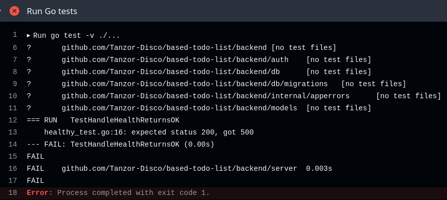

Для проверки отсутствия деплоя были сохранены сведения о работающем контейнере до и после неуспешного запуска:

| Признак | До неуспешного CI | После неуспешного CI |
| --- | --- | --- |
| ID контейнера | `edc9c386c8aa` | `edc9c386c8aa` |
| Digest образа | `sha256:58d919a5df5974be863b6cf1324120baa85d61ef86e93dcaa16669f90121432a` | Тот же digest |
| Ответ `/health` | `HTTP/1.1 200 OK` | `HTTP/1.1 200 OK` |

Исходные данные: [before.txt](lab3/bad-code/before.txt), [after.txt](lab3/bad-code/after.txt), [health-before.txt](lab3/bad-code/health-before.txt), [health-after.txt](lab3/bad-code/health-after.txt). Полные SHA сохранены в [working-commit.txt](lab3/bad-code/working-commit.txt) и [rejected-commit.txt](lab3/bad-code/rejected-commit.txt).

Всё по кайфу, забракованый коммит ничего не деплойнул.

После возврата `http.StatusOK` тест снова прошёл: [Good CI № 8](https://github.com/Tanzor-Disco/based-todo-list/actions/runs/38797156629).
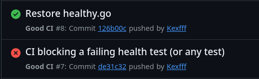


## 6. Эксперимент: security-gate блокирует уязвимый образ

### 6.1. Как настроена блокировка

Сначала Trivy сохраняет полный JSON-отчёт с `--exit-code 0`, чтобы результаты были доступны даже для уязвимого образа. Затем отдельный шаг проверяет порог допуска:

```bash
trivy image \
  --image-src docker \
  --scanners vuln \
  --severity CRITICAL \
  --exit-code 1 \
  --skip-db-update \
  "$IMAGE"
```

`--severity CRITICAL` выбирает критические находки, а `--exit-code 1` делает их наличие ошибкой шага. Флаг `--skip-db-update` позволяет при повторной проверке внутри запуска использовать уже загруженную базу. HIGH учитываются в отчёте, но не останавливают пайплайн.

Загрузка отчётов в artifacts выполняется с `if: always()`, поэтому результат сканирования сохраняется и после срабатывания блокировки.
``` yaml
      - name: Upload vulnerability reports
        if: always()
        uses: actions/upload-artifact@cf430e030ddbb5b0abf93d22962f4752f3646cd9 # v7.0.2
        with:
          name: trivy-reports-${{ github.sha }}
          path: trivy-reports/
          retention-days: 30
          if-no-files-found: ignore
```

### 6.2. Образ с намеренно устаревшей основой

В коммите `c7b8e0e5b0b9e930faebb4c463b8183498eb8e55` (zhirniy debian v dockere (security gate)) параметр `file` в шаге Buildx временно переключён с `backend/Dockerfile` на `backend/Dockerfile.vulnerable`.

В экспериментальном Dockerfile использовался компилятор Go `1.26.4` и старый толстый Debian:

```dockerfile
FROM golang:1.26.4 AS builder
# Загрузка модулей и сборка CGO_ENABLED=0 go build ...

FROM debian:bullseye-20210902@sha256:2c4d8b742bed07efe6d262942d9ebdbe2143f6aeb76d2935807e1b81385b974a
WORKDIR /app
COPY --from=builder /app/todo-backend .
USER 65532:65532
CMD ["./todo-backend"]
```

Здесь использован конкретный старый снимок Debian, чтобы получить воспроизводимый пример накопленных CVE.

В [Good CI № 9](https://github.com/Tanzor-Disco/based-todo-list/actions/runs/38798842923) сборка завершилась, но шаг `Block CRITICAL vulnerabilities` упал. Образ не был опубликован этим workflow, job деплоя была пропущена.

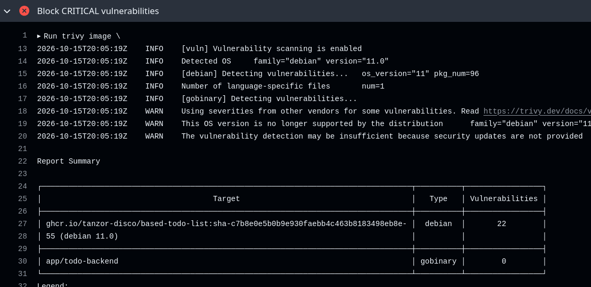

### 6.3. Что исправлено

В коммите `b266b976660b4b3f8bdb1f978fe27ec42f796a7f` (Restore Alpine runtime and update Go security patches) выполнены изменения:

1. Workflow возвращён к сборке через основной `backend/Dockerfile`.
2. Старый Debian runtime заменён на `alpine:3.22`.
3. Компилятор Go обновлён с `1.26.4` до `1.26.9`.

В этом исправлении системная основа заменена целиком + обновлен пакет go.

Примеры находок из отчёта до исправления:

| Находка | Пакет и версия до исправления | Исправление по данным Trivy | Что сделано в работе |
| --- | --- | --- | --- |
| `CVE-2021-33574`, CRITICAL | `libc6` и `libc-bin 2.31-13` | `2.31-13+deb11u3` | Старые пакеты glibc исключены вместе с Debian |
| `CVE-2026-78667`, HIGH | Go `stdlib v1.26.4` | `1.26.9` или `1.27.2` | Бинарный файл пересобран Go `1.26.9` |

Для точного повторения исходного эксперимента нужно использовать коммит `c7b8e0e`, включая тогдашний `go.mod`. В текущем `go.mod` уже требует Go `1.26.9`, поэтому одного переключения на vulnarable Dockerfile недостаточно для воспроизведения той же сборки.

### 6.4. Результаты до и после

Сравниваем [красный запуск № 9](https://github.com/Tanzor-Disco/based-todo-list/actions/runs/38798842923) и [зелёный запуск № 10](https://github.com/Tanzor-Disco/based-todo-list/actions/runs/38800647352). В обоих случаях использовались Trivy `0.76.0` и база уязвимостей версии `2` с одинаковым временем обновления: `2026-10-15 19:09:25 UTC`. Чтобы Trivy ловила одинаковые уязвимости.

| Severity | До: Debian 11.0 + Go 1.26.4 | После: Alpine 3.22.6 + Go 1.26.9 |
| --- | ---: | ---: |
| CRITICAL | **22** | **0** |
| HIGH | **149** | **0** |


Сводки CRITICAL/HIGH сохранены в репозитории: [до](lab3/security/before/severity.json) и [после](lab3/security/after/severity.json).

Скрин после исправлений
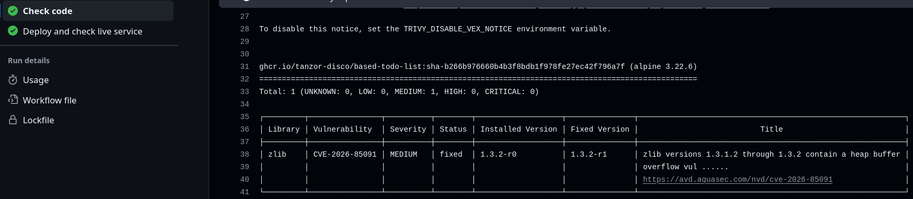

## 7. Гранд Финал

После исправления пайплайн прошёл все обязательные стадии. Финальное подтверждение полного цикла — [Good CI № 11](https://github.com/Tanzor-Disco/based-todo-list/actions/runs/38802504601), коммит `417ae4e44d9989e2d35b7abbb09f5c8c1aed25d7` (Файлики для отслеживания upload).

Этот запуск выполнил проверки, сборку, Trivy, push в GHCR, запуск Compose и HTTP-проверку. В artifact деплоя сохранена ссылка на образ:

```text
ghcr.io/tanzor-disco/based-todo-list@sha256:c5f9f3c1db23e987b74f7ab0c47d2a27d0ed871c35a9654a5dfe9448491e2e3d
```

Финальный шаг проверял сервис командой:

```bash
curl \
  --fail \
  --show-error \
  --silent \
  --include \
  --max-time 10 \
  --output deploy-evidence/health.txt \
  http://127.0.0.1:18081/health
```

Содержимое `deploy-evidence/health.txt`:

```http
HTTP/1.1 200 OK
Date: Thu, 15 Oct 2026 20:32:27 GMT
Content-Length: 0
```

Успешность подтверждается статусом `200 OK` и успешным завершением `curl`.

Вывод `docker compose ps`, сохранённый тем же запуском:

```text
NAME                        IMAGE                                                                                                          COMMAND                  SERVICE    CREATED          STATUS                    PORTS
todo-lab3-good-backend-1    ghcr.io/tanzor-disco/based-todo-list@sha256:c5f9f3c1db23e987b74f7ab0c47d2a27d0ed871c35a9654a5dfe9448491e2e3d   "./todo-backend"         backend    12 minutes ago   Up 12 minutes (healthy)   127.0.0.1:18081->8080/tcp
todo-lab3-good-postgres-1   postgres:18.6-alpine3.24                                                                                       "docker-entrypoint.s…"   postgres   58 minutes ago   Up 58 minutes (healthy)   5432/tcp
```

Backend и PostgreSQL находятся в состоянии `healthy`.

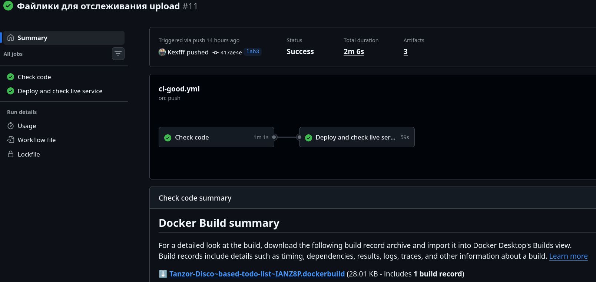

## 8. Сохранение доказательств

Workflow автоматически сохраняет два вида artifacts со сроком хранения 30 дней:

| Artifact | Содержимое | Назначение |
| --- | --- | --- |
| `trivy-reports-<SHA>` | `trivy.json`, `trivy.txt`, `severity.json`, `version.txt`, `image.txt` | Полный результат сканирования, сводка severity, версия сканера и базы, имя образа |
| `deployment-<run_id>-<run_attempt>` | `health.txt`, `containers.txt`, `image.txt` | Ответ сервиса, состояние контейнеров и digest развёрнутого приложения |

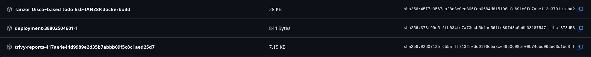

## 9. Вывод

По количеству мемов видно, что плохой пайплайн было делать веселее, а с хорошим пришлось помучаться. А ещё я устал от yaml, как же Zed плохо хэндлит отступы, видимо время начать смотреть на neovim. Я пошел удалять докеры.


наподумотт
